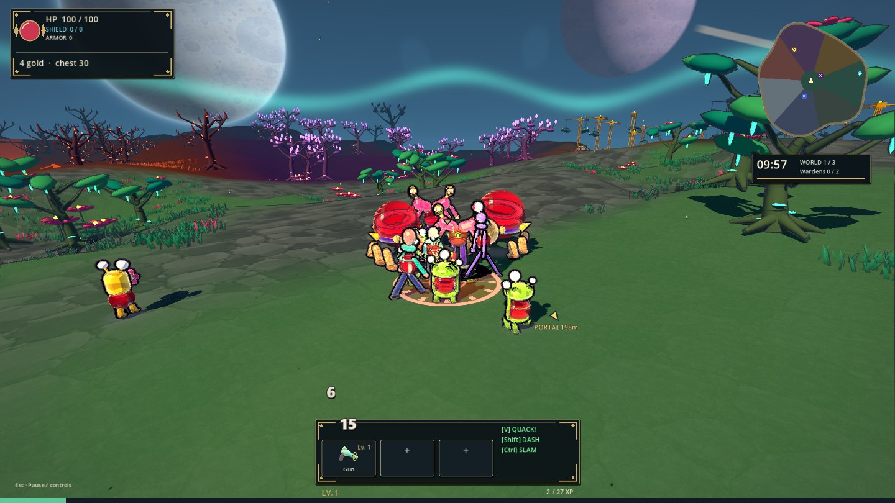
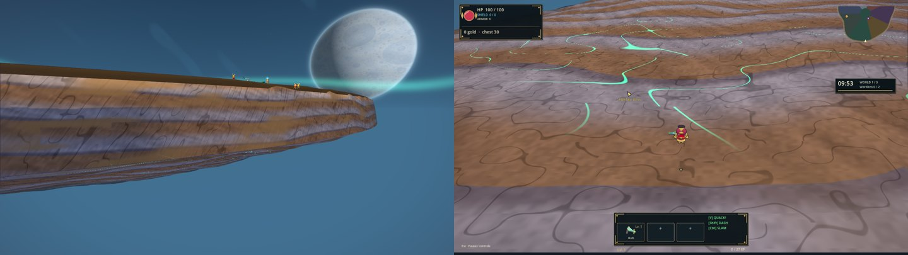
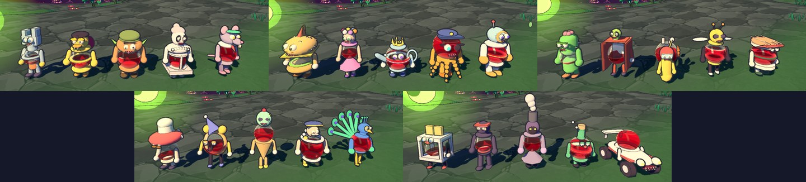
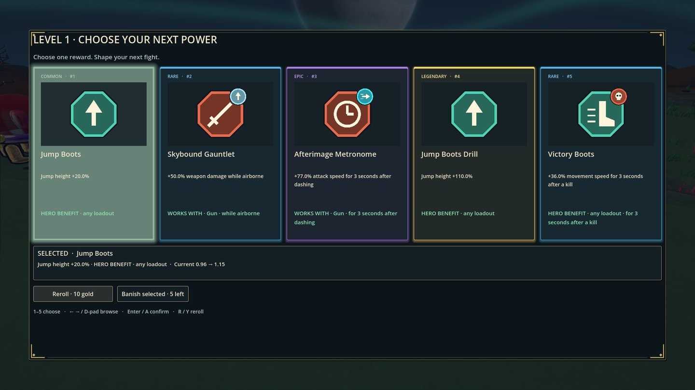
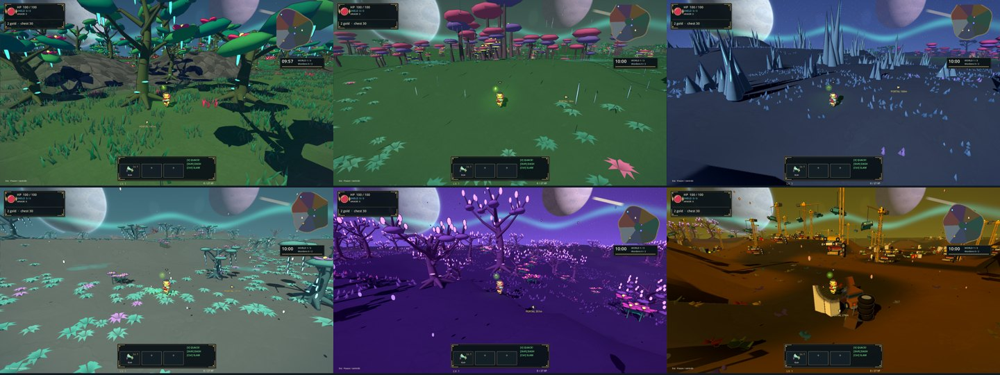
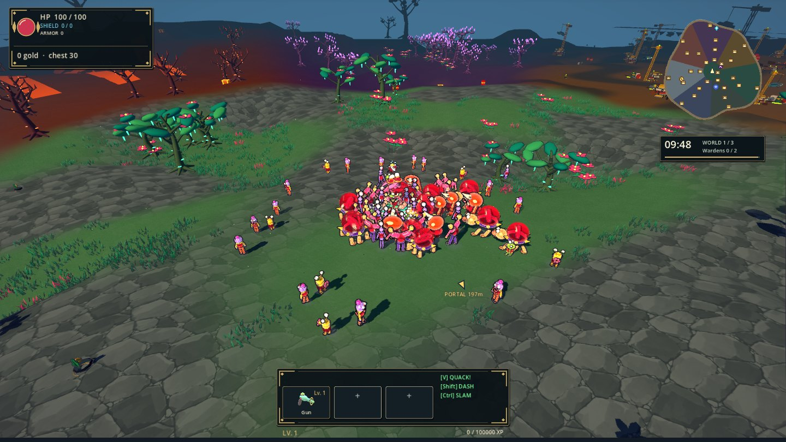
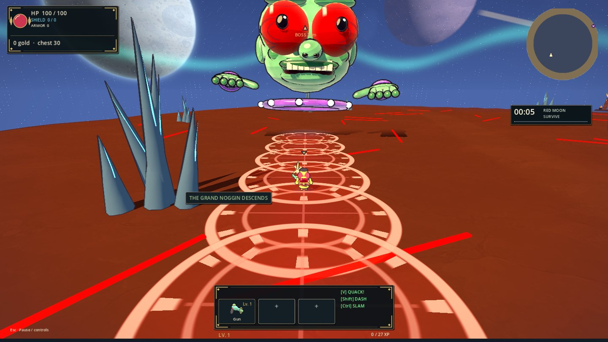
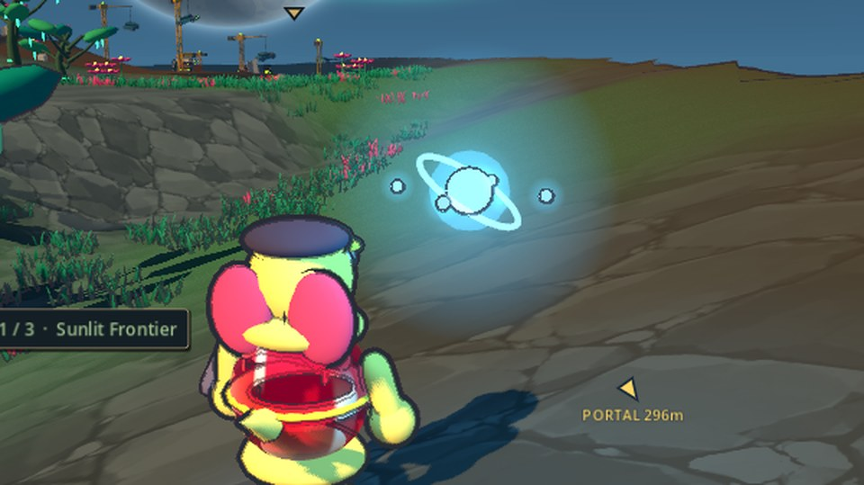
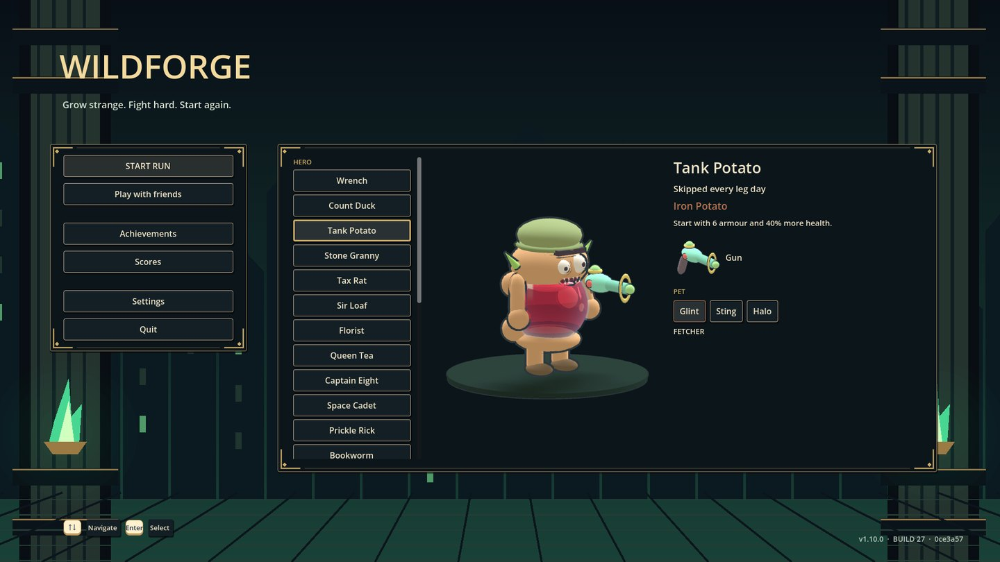

# Wildforge

**Grow strange. Fight hard. Start again.**

A cartoon survival roguelite where a duck, a white sports car and a pickle are perfectly reasonable heroes. Drop onto floating islands full of weird creatures, grab unpredictable upgrades and become outrageously overpowered before the monsters catch you. Solo or with up to three friends.

**[Download Build 29 for Windows](https://github.com/rytiss78/wildforge/releases/tag/build-29)** · [Play with friends](native/docs/coop.md) · [Share an idea or report a bug](https://github.com/rytiss78/wildforge/issues)



## New in Build 29

- **Clutch**, a first-person shooter hero: aim yourself, headshots, a 4-second aimbot on V and a sneak that makes enemies lose you.
- **Heroes that play differently:** the White Supra drifts, Honey Hustler flies, Admiral Bubbles lives on a bubble shield, Turbo Snail leaves slime, Prickle Rick is a poisonous pickle that gets shoved about.
- **Dyleris** marks three free items under the island; flower roots for Digby Mole; three more pets.
- **Co-op:** downed players spectate their friends and cheer them on.
- Clearer hero screen, potions and pickups in numbers, bosses that keep up. Seven heroes retired (20 in all).

[Full Build 29 notes](native/docs/build29-release.md)

## Build 28

- **Digby Mole** digs through the island, **Mender and Thumper turrets**, jump, slam and turrets under the island, Junkyard crushers and burning lava. [Notes](https://github.com/rytiss78/wildforge/releases/tag/build-28)

## Build 27

- **The islands float.** Walk over the edge and your hero walks upside down beneath it, out of the fight.
- **Pets are wisps** that float over your shoulder and grow with every final-boss win.
- **Glass health orbs**, a 60 fps cap, cleaner menus and calmer audio. [Notes](https://github.com/rytiss78/wildforge/releases/tag/build-27)



## Your hero. Your chaos.

Choose from 26 ridiculous heroes, each with a trick of their own on **V**. Digby Mole digs straight through the island and pops up under the enemies. Count Duck steals life. Sir Loaf dashes with a bang. Florist turns footsteps into a dangerous blooming garden. Admiral Bubbles brings a bathtub to the battlefield.



Carry three weapons at once from a pool of 73: guns, blades, flowers, turrets and four screen-filling spells. When two hands aren't enough, grow a third arm. Rank a weapon up with its catalyst and it **evolves** into a gilded new form. Mutations of fire, poison, frost, storm and stranger things combine with your spells into named synergies like Firestorm and Supercell.



## Find trouble somewhere new

Each run crosses three floating islands, every one sliced into seven biomes: **Clover Woods, Puffcap Marsh, Moon Craters, Cloudwilds, Candy Hell, Starfall Space and Junkyard Planet**. Every biome has its own creatures and its own fight mechanic: healing clover rings, poison spore fog, slippery ice, wind gusts, lava vents, gravity rifts and falling scrap crushers.



Sixty original cartoon creatures, ten per biome, from Trashcan Stan to Two-Torso Terry, babble at you in their own gibberish. Elites come shielded, splitting, blinking or berserk, and the crowds get big.



## The Grand Noggin

At the end waits the Red Moon and its final boss: a giant floating head whose two glass eyes are its health. Mid-fight it stops and demands a **performance**. Dodge every wave of marks and the crowd cheers BRAVO, cracking its eyes open for double damage; get hit once and it's BOO, and the Noggin heals. Beat it to start an endless Eclipse, and to feed your pet.



## Bring friends

Survive solo or team up with up to three friends, over the internet with an invite code or on the same Wi-Fi. Share XP and chests, pick your own cards, rescue a downed friend with an arrow code, and join a run already in progress. Done choosing before your friend? Play Block Drop until they are. [Co-op setup](native/docs/coop.md)



Pick your pet with your hero, and chase 93 achievements that unlock hats and cosmetics.



## Jump in

Download the Windows ZIP, extract the whole folder and run **Wildforge.exe**. No store account or installation is needed. Keyboard and mouse or an Xbox controller both work. Everyone in a co-op party needs the same build.

**This is a development alpha.** Balance so far comes from automated playtests, not people, and co-op has not yet been tested between two machines over a real internet connection. Some providers put homes behind a shared address (carrier-grade NAT) where no port can be opened; the game says so, and a friend can host instead. Your ideas shape what comes next: [tell us what you loved, what broke or what would be fun](https://github.com/rytiss78/wildforge/issues).

<details>
<summary><strong>Earlier builds</strong></summary>

- **Build 25 (1.8.0):** The Grand Noggin final boss and its performance, the Rift Dash card, gibberish voices for every creature, cartoon spell weapons. [Notes](https://github.com/rytiss78/wildforge/releases/tag/build-25)
- **Build 24 (1.7.0):** everything became a cartoon: 60 original enemies, new realm bosses, heroes, weapons and icons, all with health in orbs. [Notes](https://github.com/rytiss78/wildforge/releases/tag/build-24)
- **Build 21 (1.4.0):** weapon evolutions, spell-and-mutation synergies, a fight mechanic for every biome, ink and shatter deaths. [Notes](https://github.com/rytiss78/wildforge/releases/tag/build-21)
- [All releases](https://github.com/rytiss78/wildforge/releases)

</details>

<details>
<summary><strong>For builders: source, tools and controls</strong></summary>

Agents: start with [AGENTS.md](AGENTS.md). Hermes has a [quick start](HERMES.md); the [Godot workflow and troubleshooting guide](native/docs/godot-workflow.md) covers commands, test evidence, screenshots and safe local exports. Current work and known gaps are in [PLAN.md](PLAN.md).

The game uses Godot **4.7.2**. Open `native/project.godot`, allow the initial import and run the main scene. Node.js is used by the content scripts and the agent workflow. All runtime game assets are included; local tool installations and generated caches are excluded.

For Windows packaging, place the console editor at `tools/godot/Godot_v4.7.2-stable_win64_console.exe` and the release template at `tools/godot/templates/windows_release_x86_64.exe`. `scripts/fetch-export-template.py` can obtain the templates. Python and voice models are needed only when regenerating assets.

```powershell
node scripts/agent-workflow.mjs build
node scripts/agent-workflow.mjs test-build
./scripts/package-release.ps1 -BuildNumber 29 -BuildDirectory <staged build directory>
```

Published downloads use sequential build numbers. The current release is `Wildforge 1.12.0 — Build 29`, tag `build-29`, archive `Wildforge-1.12.0-Windows.zip` (with `godot_wry.dll` and its license, needed beside the executable for the video panel). Each package includes `build-info.json` with the source commit and artifact hashes, and a SHA-256 checksum file.

**Controls:** WASD / left stick moves; mouse / right stick looks; Space / A jumps; Shift / RT dashes; V / LT hero trick; Ctrl / B slams; E / X interacts; B / Y opens your build; Escape / Menu pauses. Weapons attack automatically. Walk over an island's edge to go underneath.

Achievements, scores and settings save locally in `%APPDATA%/Godot/app_userdata/Wildforge/career.json`. [Asset origins](native/assets/README.md)

</details>
