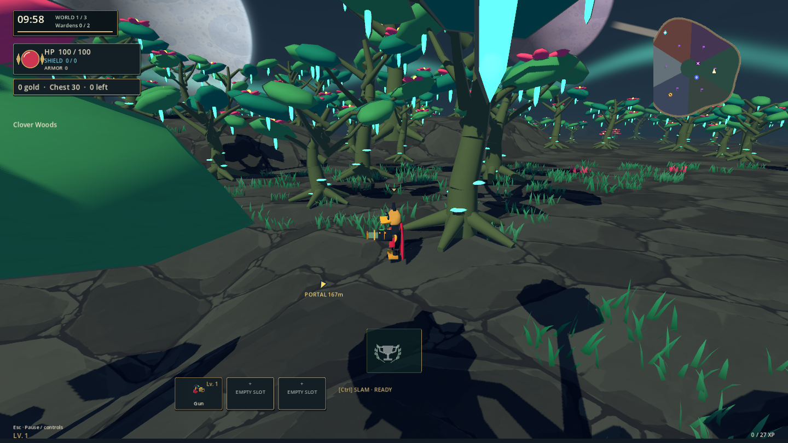
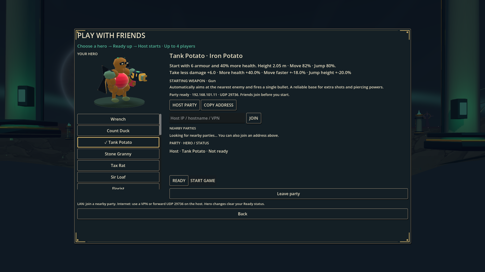
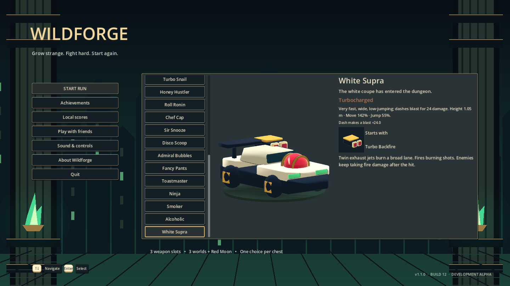
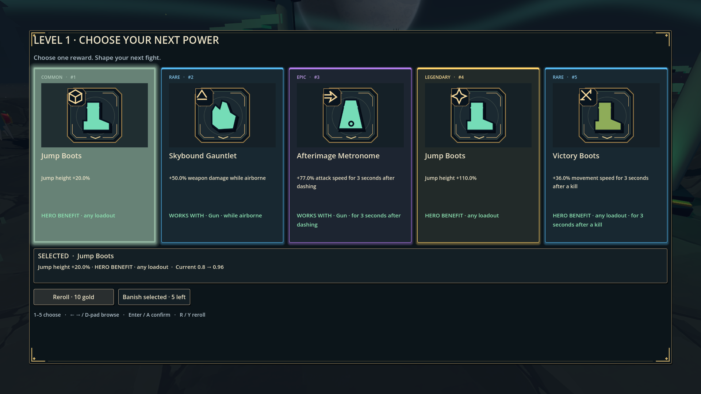

# Wildforge

**Grow strange. Fight hard. Start again.**

A vivid 3D survival game where a duck, a loaf of bread and an angry granny are perfectly reasonable hero choices. Explore strange places, grab unpredictable upgrades and become outrageously overpowered before the monsters catch you.

**[Download the latest public Windows build](https://github.com/rytiss78/wildforge/releases/tag/build-16)** · [Play with friends](native/docs/coop.md) · [Share an idea or report a bug](https://github.com/rytiss78/wildforge/issues)

**Build 17 is in development; no new public build is available yet.** Its current work includes corrected camera-relative minimap rotation, the immense stylized Baron with steam, biome foliage/moss and low mist, and dodgeable enemy contact warnings. [Development evidence and remaining plan](native/docs/build17-work.md).

The third map leads to the Red Moon, where an immense, slow Baron waits with four visible steam vents and deadly, telegraphed attacks. He is a stylized original fallback, not a photorealistic or officially licensed film model. Defeat him to begin an endless Eclipse. The refreshed six-biome ground/color views and the controller, music and Lithuanian speech checks have been accepted. Comparable late-Eclipse performance measurements are complete, with high physics-time spikes recorded. Full-fight balance and the reported early-game co-op desynchronization remain open; Build 17 will stay unpublished until the plan is complete.

For the public download, unpack all files together and run `Wildforge.exe`. Source development uses `node scripts/native.mjs`. Co-op players need the same game version. Each verified export includes a manifest of its source commit and executable/pack hashes.



*Natural groves and short grass; the refreshed six-biome ground/color pass was accepted for Build 17.*



*Choose your hero and join a party.*

## Your hero. Your chaos.

Choose from 25 ridiculous heroes, each with their own trick. Count Duck steals life. Sir Loaf dashes with a bang. Florist turns footsteps into a dangerous blooming garden. Admiral Bubbles brings a bathtub to the battlefield.

Carry three weapons at once. When two hands aren't enough, grow a third arm. Mix guns, blades, flowers and turrets with fire, poison, frost, ghosts, thorns and strange money tricks. Every upgrade helps you grow stronger; the next chest might send your run in a completely different direction.



*White Supra brings speed, a wide turning footprint and backfire weapons.*

## Find trouble somewhere new

Roam through Clover Woods, Puffcap Marsh, Moon Craters, Cloudwilds, Candy Hell and Starfall Space. Hunt for treasure, jump over trouble, squash enemies underfoot and face huge bosses as the clock ticks down.

Spend your coins on a chest, choose one of five rewards and keep building your ridiculous little disaster. Chase 108 achievements built around exploration, clever combinations and unusual challenges.



*One choice. More trouble for the monsters.*

## Bring friends

Survive solo or team up with up to three friends. Share XP, levels and chest opportunities, choose your own upgrades and discover what happens when four questionable heroes meet the same boss.

On the same Wi-Fi, host a party and let friends join from the nearby-party list. Remote friends can join by address using a shared VPN or port forwarding. [Co-op setup](native/docs/coop.md)

## Jump in

Download the Windows ZIP, extract the whole folder and run **Wildforge.exe**. No store account or installation is needed. Keyboard and mouse or Xbox controller both work.

**This is a development alpha.** Expect rough edges and plenty of changes. Your ideas can help shape what comes next: [tell us what you loved, what broke or what would be fun](https://github.com/rytiss78/wildforge/issues).

<details>
<summary><strong>For builders: source, tools and controls</strong></summary>

Agents: start with [AGENTS.md](AGENTS.md). Hermes has a [quick start](HERMES.md); the [Godot workflow and troubleshooting guide](native/docs/godot-workflow.md) covers commands, test evidence, screenshots and safe local exports.

The game uses Godot **4.7.2**. Open `native/project.godot`, allow the initial import and run the main scene. Node.js is used by the content scripts. All runtime game assets are included; local tool installations and generated caches are excluded.

For Windows packaging, place the console editor at `tools/godot/Godot_v4.7.2-stable_win64_console.exe` and the release template at `tools/godot/templates/windows_release_x86_64.exe`. `scripts/fetch-export-template.py` can obtain the templates. Python and voice models are needed only when regenerating assets.

```powershell
node scripts/native.mjs
./scripts/package-native.ps1
./scripts/package-release.ps1 -BuildNumber 17 -BuildDirectory build/baron-1.1.3-build17 -SourceCommit HEAD
./scripts/test-coop.ps1 -Packaged -RenderedClient
```

Published downloads use sequential build numbers. This release is `Wildforge 1.1.3 — Build 17`, tag `build-17`, archive `Wildforge-1.1.3-Windows.zip`. The game remains a development alpha. Packaging includes `build-info.json` and a version-specific SHA-256 checksum. Pass `-BuildDirectory` and its exact `-SourceCommit` when packaging a verified staging directory.

WASD / left stick moves; mouse / right stick looks; Space / A jumps; Shift / RT dashes; Ctrl / B slams; E / X interacts; B / Y opens your build; Escape / Menu pauses. Weapons attack automatically. Florist plants while moving.

Achievements, scores and settings save locally in `%APPDATA%/Godot/app_userdata/Wildforge/career.json`. [Build notes](native/docs/build-0.8.3.md) · [Asset origins](native/assets/README.md)

</details>
