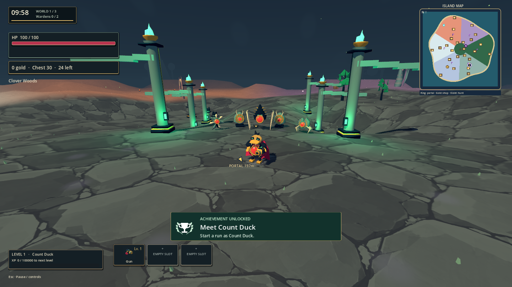
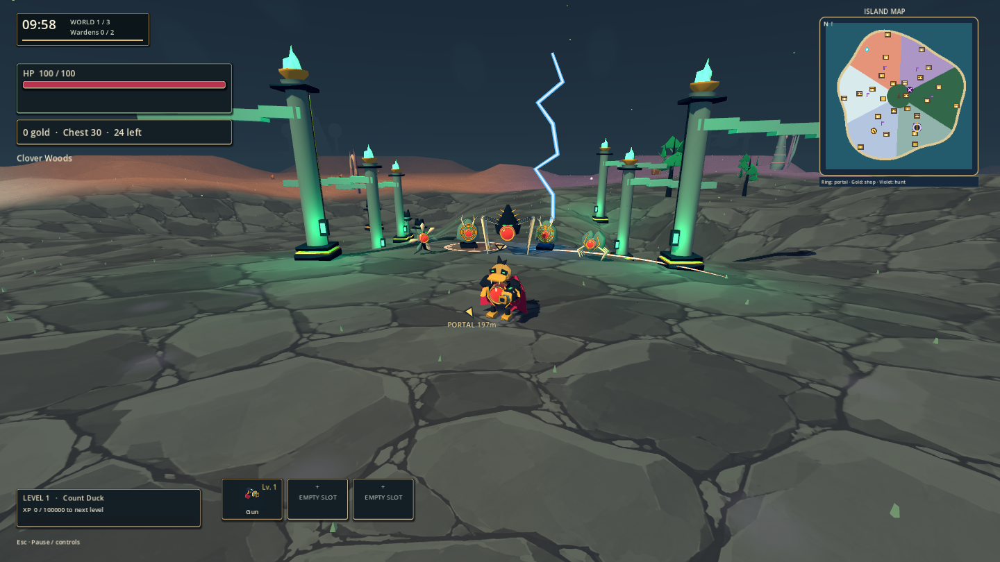

# Ground, lighting and combat-art development checkpoint

October 12, 2026. Source development on `main`; version remains 0.8.10. This applies the [corrected Hades direction](../hades-style-research-1.0.0.md), following the user's request to prioritize development and leave full testing to the end.

Clover Woods paving now uses a quiet slate value range with no terrain emission or pervasive gold/green highlights. Lower ambient light and a darker sky support pools of green light cast by visible inset column lamps. Camera controls and terrain/collision geometry are unchanged.

Shared combat effects now use sharp mesh fragments, tapered melee crescents, two-layer blue/white lightning and beams, and a layered explosion with an opening flash, curling orange lobes, a broken ground ring and brief local light. Poison has clearer green curls; gravity uses purple filaments around its dark center. Explosion peaks clear rapidly enough to reveal nearby enemies and warning marks in the inspected scene. Effects share the existing lifetime/cleanup list; at most 28 combat-effect roots and three transient lights are admitted. These caps are implementation limits, not measured performance results.

## Light validation

- `check` passed: `.build-staging/agent-workflow/2026-10-12T19-46-37-513Z-check/result.json`. JavaScript tests, Godot import and script parsing; logs inspected without script errors or warnings.
- `style-review` passed: `.build-staging/agent-workflow/2026-10-12T19-47-01-285Z-style-review/result.json`. Eight fresh 1440x810 screenshots visually inspected: idle, warning, initial impact, expansion, recovery, lightning/melee, gravity and poison. Camera assertions, actual explosion HP loss/damage credit, and combat-effect expiry pass. Logs are clean.
- The first review at `2026-10-12T19-44-29-362Z-style-review` failed because its new accounting assertion queried `explosion`; the existing API records `effect:explosion`. Corrected the fixture to use the actual key and also require HP loss. Its screenshots exposed the new effect root incorrectly inheriting generic shrinking; fixed root scale so lightning reaches its target and explosion expansion is preserved. Original failure evidence remains in staging.
- No full integration, co-op, performance run or export in this batch, per the user's reduced-testing instruction. The previous executable does **not** contain these changes. Run source using `node scripts/native.mjs`.

Fresh source captures:

## Remaining work

This is a representative scene and shared VFX checkpoint, not completion of the overhaul. The other five biome palettes/scenery, full hero/enemy/weapon and icon catalogs, UI, obsolete-asset audit, and final release checks remain on the [roadmap](visual-overhaul-1.0.0.md). Distant older terrain still appears in the captures. Melee silhouette and dense-combat readability need broader play coverage. Existing integration teardown diagnostics and Eclipse expectation mismatch remain open; this light review does not resolve or waive them.
