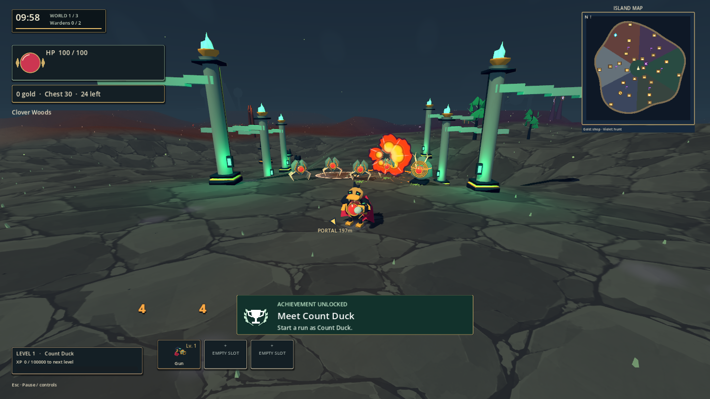
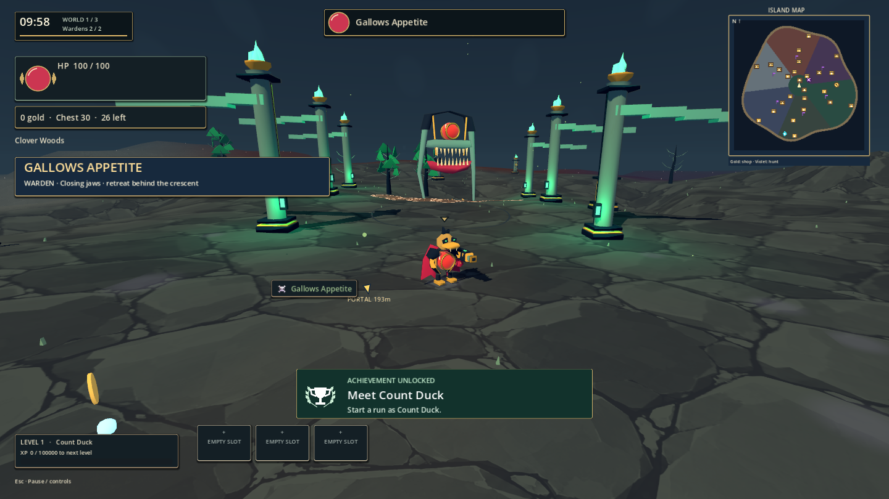

# Wildforge 1.0.0 — local visual-overhaul build

October 13, 2026. Source development version 1.0.0; GitHub Build 4 remains the published download. No new GitHub release has been published by this work.

## Changes

- Original angular hero/enemy models, six distinct scenery families, eight rotating monster bosses, new harvestables and weapon artwork.
- Quiet slate terrain, deep shadow colors, localized emerald lights and saturated combat flashes, shards, lightning and area effects.
- Engraved reward, potion and achievement icons; dark menu/card panels; in-game About; minimap styling.
- Glass health orbs retained on heroes, enemies, bosses and remote players. HUD health uses an orb with a separate shield arc. Damage numbers rise from the lower screen.
- Existing third-person camera settings, weapon behaviors, save format and original achievement sound retained.
- Superseded sprite assets and obsolete generators archived locally and removed from current source. [Deletion manifest](visual-cleanup-1.0.0.json), [rollout details and acceptance changes](visual-rollout-1.0.0.md).

## Validation and executable

Run `G:/game/build/visual-1.0.0/Wildforge.exe`, keeping its neighboring `Wildforge.pck`. The folder includes licenses and `build-info.json`. Packaged binaries match the tested export byte-for-byte; historical builds remain intact.

Reports are under `G:/game/.build-staging/agent-workflow/`. All have `success: true`; their final logs contain no script errors or engine error/warning lines.

| Check | Result | Evidence |
| --- | --- | --- |
| check | Passed | `2026-10-13T08-01-25-286Z-check/result.json` |
| fresh-import | Passed | `2026-10-13T07-47-03-962Z-fresh-import/result.json` |
| smoke | Passed | `2026-10-13T07-47-28-997Z-smoke/result.json` |
| integration | Passed | `2026-10-13T07-38-58-658Z-integration/result.json` |
| eclipse-review | Passed | `2026-10-13T08-01-10-534Z-eclipse-review/result.json` |
| coop | Passed | `2026-10-13T07-40-17-525Z-coop/result.json` |
| combat-review | Passed | `2026-10-13T07-47-36-842Z-combat-review/result.json` |
| build | Passed | `2026-10-13T08-01-37-366Z-build/result.json` |
| release-review | Passed | `2026-10-13T08-02-54-437Z-release-review/result.json` |

Smoke and exported smoke each passed 118 checks; integration passed 59. Real host/client co-op completed the 0 → 1 → 2 → 0 realm route. Actual exported menu navigation, hero selection and About reopening passed at 720p/1080p. Exported orb/camera, combat, all eight bosses and all six streamed biomes passed. Rendered captures and the full roster contact sheets were visually inspected. The roster report is `2026-10-13T07-36-44-304Z-roster-review/result.json`. See [acceptance corrections](visual-rollout-1.0.0.md) for semantic icons and Eclipse handling. The Eclipse test now allows mixer time between music transitions and releases audio before exit, resolving its earlier exit-only resource diagnostics.

The combat sample on RX 9060 XT covered 656 frames: p50 17.824 ms, p95 34.536 ms, 5,177 peak nodes and 1,551 draw calls. Baseline p50/p95 were 17.461/35.024 ms over 657 frames. These stochastic samples show similar frame times, not a proven speedup.

A clean copy imported without `.godot` cache and passed smoke. The final pack contains expected scene/new-icon paths and no deleted asset paths (including import-sidecar paths) from the cleanup manifest; exported runtime checks additionally exercised resource loading. The manifest contains 2416 explicitly archived files.

### Artifact identity

Source head at export: `63d60d9efcd55229758a87dc245de4dd61f4a854`; working-tree diff SHA-256: `1eb4d71a972111350d6f18d60ebc45862ee110ce13ec5c8eedc3f4fbeee3a306`. This is a tested working-tree build including separately preserved local edits, not a clean-commit export. Final documentation/screenshots were added afterward.

| File | SHA-256 |
| --- | --- |
| `Wildforge.exe` | `34c34628db7ce7f67159c2c1f90a4cbeeedd6b13d8765810f283a32227c6f506` |
| `Wildforge.console.exe` | `c8ee2be07d46241fa68af3d3e106d58e1b29527d389619c7168d44af169364f8` |
| `Wildforge.pck` | `0c8fdacd58619976d5af637b139c05db7fc81122d1c14a80c5962a30c9ba9296` |

### Exported screenshots

Source milestones are on `main` (`dee8240`, `63d60d9`, followed by the final metadata/evidence checkpoint). GitHub Build 4 remains the public download. One repeated exported 720p UI review (`2026-10-13T08-01-54-716Z-release-review`) returned an aggregate assertion failure despite saving every capture; the harness did not identify the individual assertion. Previous runs passed. The final rerun outcome is recorded above; this intermittent harness failure still needs per-assertion diagnostics and remains a limitation.

The eight newly requested October 13 tasks are open in [PLAN.md](../../PLAN.md), including removing boss screen indicators, further UI/orb redesign, denser lighting, directional dash, harder ranged enemies, a final arena, creepy biome enemies and a celestial sky.

## Limits

This is original procedural 3D artwork informed by the Hades visual hierarchy, not a recreation of its hand-painted assets. Equivalent bonuses deliberately share glyphs. Frame timings are workload dependent; no performance improvement is claimed. A local game/map/armour edit and an exploratory GLB were preserved separately from the source commits.
