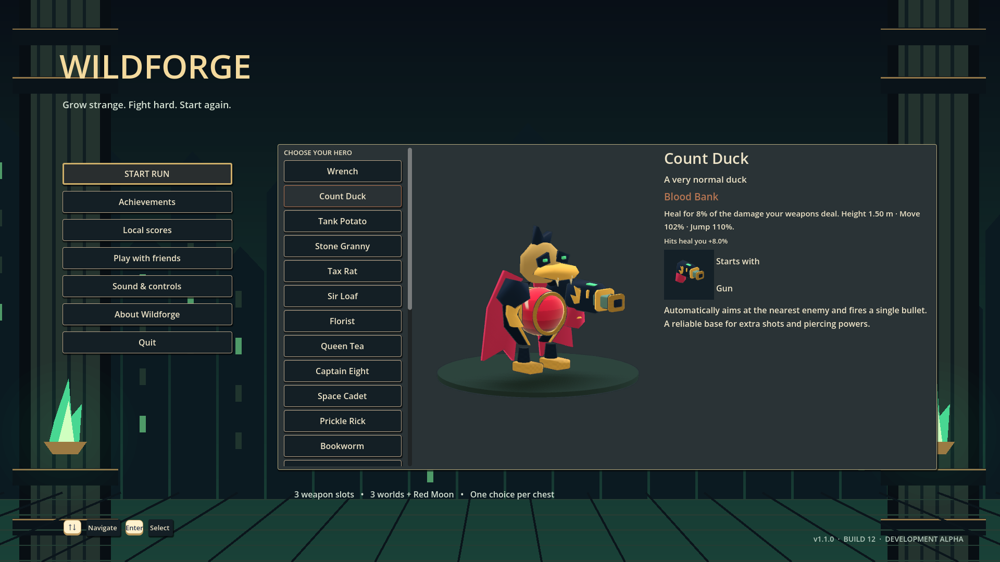
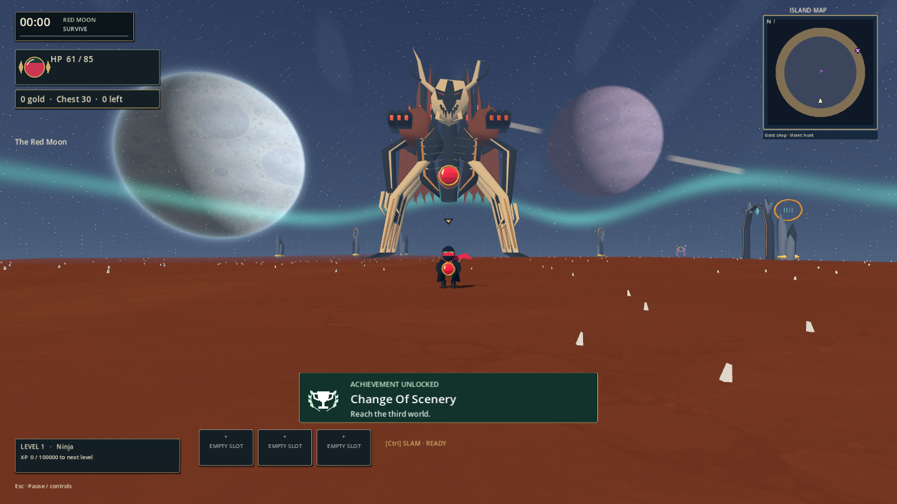
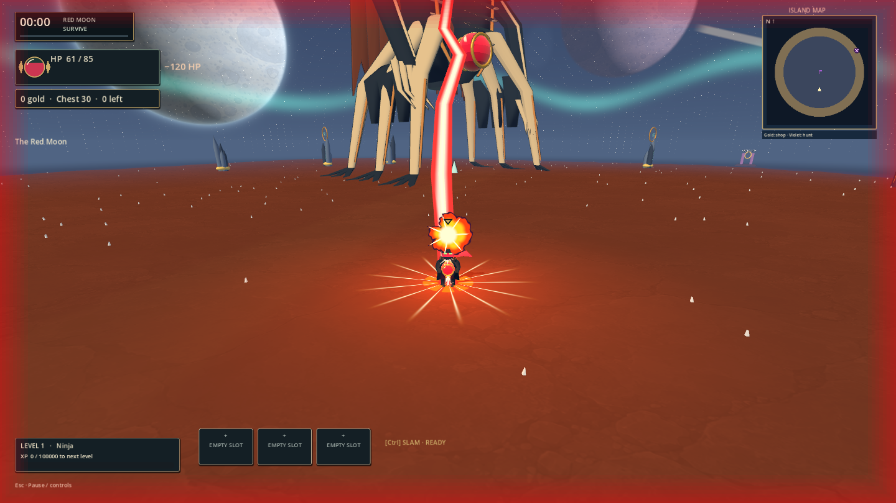

# Wildforge 1.1.0 — Build 12

October 13, 2026. [Windows download](https://github.com/rytiss78/wildforge/releases/tag/build-12). Development alpha, published as a normal GitHub release. Previous public build was v0.8.10-alpha / Build 11; older references to Build 4 were stale.

## Changes

- The Red Moon follows the third portal. The Red Observatory is a 42 m angular skeletal colossus: six legs, carved skull, broken cathedral spires, shoulder cannons and long blade claws. It moves at 0.22 m/s and uses four warning patterns dealing 95–120 base damage. Death starts permanent, escalating Eclipse. The old smaller rounded design was superseded after user feedback.
- Four new heroes and class weapons: Ninja, Smoker, Alcoholic and White Supra. The complete 25-hero roster has explicit size, speed and jump profiles. Six new original creepy biome creatures bring the roster to 42 species, with correlated size/health/speed variation and different approach routes.
- Directional dash snapshots movement input. Slam and head-stomp share a 4.5-second recovery; no baseline instant kills. Rebound Gear, jumps, bounce and elemental upgrades build toward slam chains. More dangerous ranged enemies retain locked warnings and dodge windows.
- Compact HUD; health orbs replace boss bars/nameplates. Selected turret and current deployment/switch bindings are visible. Stronger damage feedback, bright slam/dash/nova/heal effects and twelve new synthesized effect sounds. Main menu and About read v1.1.0 / Build 12 from project metadata.
- Denser scenery, localized glow/shadows, restrained ground and bright celestial objects. Six massive, traversable biome buildings replace the feel of only trees/towers.
- Original simpler phonk stems for ordinary play. Eclipse uses an EQ-adjusted version of the existing synthesized PARANOIA-derived arrangement, 5 dB quieter; original file preserved. This is not a new original composition. See [asset provenance](../assets/README.md).
- Quick hero/weapon/item/drop balance pass: 69 weapons, 738 upgrades including 400 conditional augments, and 108 achievements. Innate luck now affects potion drops; capped legendary scaling is less extreme. [Calculations and limits](balance-1.1.0.md).

## Executable and evidence

Local executable: `G:/game/build/red-moon-1.1.0-build12/Wildforge.exe`. Keep its neighboring pack and files. Earlier builds and failed logs are preserved. The convenient copy matches the tested export byte for byte.

Reports below are under `G:/game/.build-staging/agent-workflow/`. All listed reports pass; inspected logs contain no script/runtime error or warning lines.

| Action | Report |
| --- | --- |
| check | `2026-10-13T09-53-25-007Z-check/result.json` |
| smoke | `2026-10-13T09-53-50-223Z-smoke/result.json` |
| integration | `2026-10-13T09-53-50-222Z-integration/result.json` |
| build | `2026-10-13T09-55-33-357Z-build/result.json` |
| red-moon-review | `2026-10-13T09-53-50-222Z-red-moon-review/result.json` |
| playfeel-review | `2026-10-13T09-33-15-515Z-playfeel-review/result.json` |
| coop | `2026-10-13T08-51-32-590Z-coop/result.json` |
| roster-review | `2026-10-13T08-52-16-115Z-roster-review/result.json` |
| biome-review | `2026-10-13T08-52-57-346Z-biome-review/result.json` |

Smoke and exported smoke each pass 118 checks; check passes all 15 JavaScript tests plus Godot import/parse. Integration covers all 44 weapon behavior branches. Red Moon review uses the actual third-portal interaction, hero buttons, attack resolution, real dodges, slow locomotion, short-range firing/hits, boss death and endless Eclipse. It also catches the hidden final-arena portal prompt regression.

Playfeel review verifies slam recovery/progression, actual remapped turret inputs, authoritative remote stomp recovery, seeded drop samples, audio playback/loop/pause/ducking and collision-tested walkthroughs of all six large buildings. Roster sheets and building/damage/slam captures were visually inspected.

The two-process co-op run completed 0 → 1 → 2 → 3 → 0 with final boss death/Eclipse on both peers. That soak precedes the final giant-model revision; the final revision separately checks serialized identity, collider metadata and authoritative attack paths. It does not establish internet relay quality.

Final exported review: `G:/game/.build-staging/exported-build12-1791885392019/result.json`. Actual menu navigation, hero changes, reopening and version label pass at 1280×720 and 1920×1080; final arena review runs at 1440×810. Menu and boss screenshots were inspected. Prior complete exported playfeel review remains at `.build-staging/exported-1.1.0-1791884050998/result.json`; that earlier executable has the superseded round boss.

## Artifact identity

Export report: `2026-10-13T09-55-33-357Z-build/result.json`. Source head during export: `58ee07b311a0282b5b1fbe6d913f4757c26db1ef`; tracked working diff SHA-256: `2d7e6ff7f891fe5fc6ab82a10e8512bc803614d0cc6337b9c0bb19fa423b09ca`. The report also hashes new files. Documentation/screenshots were finalized afterward.

The Git checkpoint excludes incoming local edits to blood rain/Eclipse contact damage, portal minimap markers and armour-glass rendering, plus an unused exploratory GLB. These remain intact in the working directory and are included in the tested binary. The ZIP includes `local-source-overrides.zip` and `source-state.json` so this difference from the source commit is explicit and recoverable. This is a tested working-tree export, not a clean-commit build.

| File | SHA-256 |
| --- | --- |
| `Wildforge.console.exe` | `29dfd11b39e11dba7b43eec1ef89d58560cab1f16c66396237341fb2e298507c` |
| `Wildforge.exe` | `dd2943602cefab498b77ebe4e36444c9aebae3ede5cf01e875fe012d46548f0f` |
| `Wildforge.pck` | `b6e3084e295db70ccb53f1d1763a3c6fba5000c27490b1bc95ffacffc6aaf36a` |

## Remaining work

- The 90,000 solo HP target equals five minutes at 300 applied DPS; weak/strong late-game builds and party sizes still need representative player testing. Party HP adds 65% per extra hero.
- Subjective audio listening/loop smoothness, gamepad feel, long-run build diversity and creepypasta reference/encounter refinement remain open. Automated audio checks are not an audition.
- NodeTunnel is intentionally deferred. No new relay service or external tunnel was installed.
- Historical intermittent 720p UI aggregate failure (`2026-10-13T08-01-54-716Z-release-review`) remains unexplained. Per-assertion diagnostics are now present and current runs pass. Original failure evidence is retained.
- Earlier bake/import and review-harness failures are preserved: `08-42-59-796Z-bake-roster`, `08-44-53-127Z-red-moon-review`, `09-18-56-643Z-playfeel-review` (all October 13). Fixes were import ordering, exercising the real selector entry, and advancing the actual effect cleanup callback; no assertions were relaxed. The first building capture location was outside the coast in two biomes; later captures moved inland and added actual walkthroughs.
- No new performance improvement is claimed; large-scene frame costs need comparable measurements.

