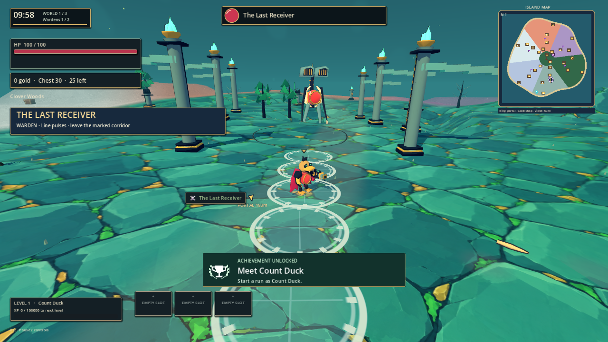
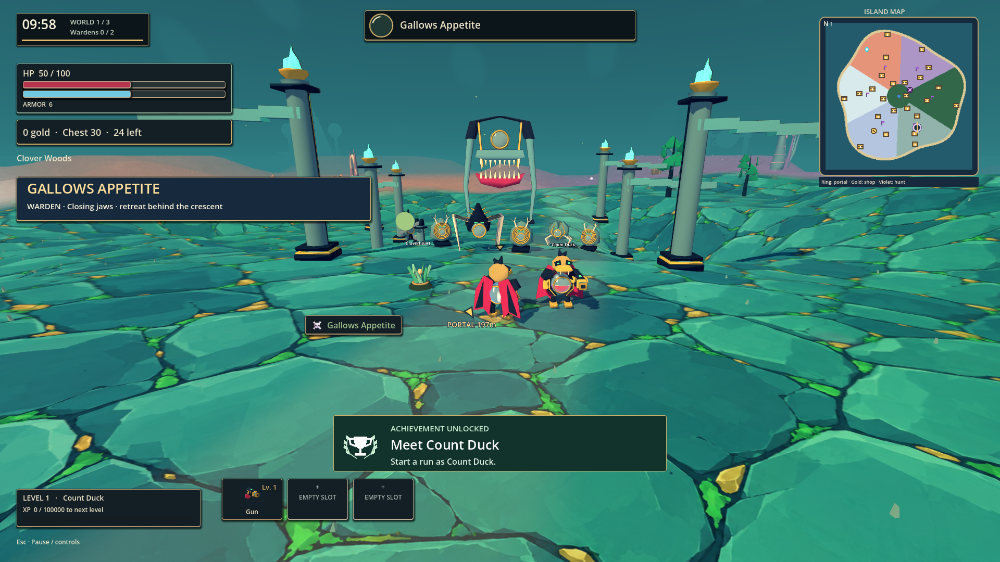

# Eight-boss development checkpoint for 1.0.0

Work in progress. Version remains 0.8.10; the full visual overhaul is not released.

**Subsequent user review:** the ground in this checkpoint is too bright. The technical checks below remain valid, but the palette is not an accepted visual target. Follow the [Hades reference study and corrected direction](hades-style-research-1.0.0.md): quieter ground, saturated effects and deliberately placed lighting.

Eight original modeled bosses now enter normal warden and portal-guardian encounters. Host selection uses a seeded, biome/realm-weighted shuffle bag: all eight appear before reuse, with no consecutive repeat at a bag boundary. Snapshots and kill messages carry the selected identity; clients never roll their own boss. Each model has an exposed health vessel, slow articulated motion, distinct silhouette and attack layout. Phase two increases damage and cadence without removing dodge time.

| Boss | Height / collision radius (m) | Structure / attack |
| --- | --- | --- |
| The Last Receiver | 12 / 1.8 | Forked acoustic crown, cable spine / five delayed corridor pulses |
| Mourning Bell | 10.5 / 2.3 | Bell canopy, chains, stilts / two staggered rings with gaps |
| Lantern Ossuary | 9 / 2.2 | Ribbed lantern, hood, hooked arms / five-point crossfire |
| The Hollow Procession | 9.5 / 2.5 | Three hanging masks inside a walking arch / parallel marching trails |
| Witness of Knots | 8 / 3.3 | Six jointed legs, asymmetric eye stalks / locked triangular marks |
| The Drowned Spire | 11.5 / 2 | Coiled masonry and hanging ribbons / outward spiral with open center |
| Gallows Appetite | 10 / 2.9 | Suspended toothed jaws under a gallows / frontal closing crescent |
| Antler Reliquary | 11 / 2.6 | Root buttresses and branching crown / three root spokes |

New terrain-conforming warnings have a countdown sweep and distinct palette. Every attack gives at least 1.5 seconds of warning; marks have 1.6-2.0 m radii. The existing guardian bonus attack and rewards remain. Received hazard messages are visual-only on clients, preventing duplicate damage from local expiration plus the host's damage packet. Co-op protocol changed to `wildforge-forge-boss-7` so older builds cannot join a roster they cannot render.

## Validation and expectation changes

The final focused source review passes at `2026-10-12T19-04-13-961Z-boss-review`: all eight through the normal spawner, live combat timer, full/half/low/empty/healed orbs, joint animation, serialized network identities, identical engine collider shapes, terrain-clear warning vertices, death/free chest/warden credit, and the real portal interaction/guardian defeat path. Four seeds run three complete eight-boss cycles. All eight rendered silhouettes were inspected; hashes alone were not used as visual proof.

Visual review found clockwise/concave panels producing hidden front faces. `build-forge-slice.py` now normalizes winding and triangulates concave silhouettes. The first scene assets and all bosses were rebuilt through the scoped baker. The original dark-mask captures remain in `2026-10-12T18-42-23-012Z-boss-review`; corrected faces are in `18-45-43-501Z-boss-review`.

The old integration `huge_boss` check required every boss to have radius >=2.8 and height >=9. That represented the previous single enlarged-creature shape. The new roster deliberately includes slender tall bodies and an 8 m wide-legged watcher. New acceptance is the exact authored dimensions above, height >=8, and identical host/client collider dimensions. Independent eight-boss runtime/collider and rendered coverage passed before updating that legacy assertion. Radius comparisons against engine properties use float tolerance; comparisons of actual engine collider dimensions remain exact. This is a changed shape specification, not a relaxed pass for mismatched colliders.

The warning test initially checked the root origin against the ground. The new mesh stores ground clearance in each vertex instead. The replacement assertion inspects all actual transformed vertices and requires 0.085-0.095 m clearance (0.09 m intended), and the attack is triggered via `update_combat`, not only the pattern helper.

The six-minute soak's documented expected route is 0 -> 1 -> 2 -> 0. Startup now explicitly suppresses a redundant realm broadcast, while subsequent transitions broadcast even when returning to 0. The test records every realm entry on both peers and requires the complete route, plus a peer completion handshake before teardown. Its obsolete final realm==1 check is replaced with the independently specified route and final realm==0. Boss identity and remote vitals checks are added; no existing discovery/combat/revive/purchase/hunt/guardian checks are removed.

The workflow's old diff fingerprint could hash only spawnSync's truncated prefix when pre-existing staged executables made the binary diff large. Fingerprinting now streams the entire diff, and separately records untracked asset hashes. A >2 MB binary fixture verifies full-stream hashing. Earlier reports' diffSha256 fields should not be treated as complete source fingerprints; checkpoint commits, preserved patches and file inventory provide the recovery record.

## Brighter visual direction

The user found the first scene too muted compared with the Hades references. This checkpoint replaces the noisy basalt ground with clean painted teal/jade slabs, removes terrain desaturation, changes muddy green fill light to cool blue, strengthens the warm key light, and raises the authored crimson, ivory, emerald and gold pigments. Batched spectral flames retain an explicit emissive tag. Camera, terrain geometry and player movement remain unchanged. The texture prompt and origin are recorded in `native/assets/illustrated/README.md`.

The previous scene is preserved in `2026-10-12T18-56-46-112Z-forge-review`; the brighter scene and full/half/low/empty/remote HP captures are in `2026-10-12T19-03-43-102Z-forge-review`. These are actual rendered gameplay fixtures, not image-edited mockups. All eight brighter boss silhouettes and attack warnings were inspected from `19-04-13-961Z-boss-review`. The floor, terrain-conforming warnings, crimson health vessels and dark outlines remain distinct.

## Regression evidence

All paths below are under `.build-staging/agent-workflow/`.

- `2026-10-12T19-03-21-181Z-check`: JS tests and Godot import/parse pass, clean diagnostics.
- `2026-10-12T19-05-12-840Z-smoke`: 118 checks pass, clean diagnostics.
- `2026-10-12T19-05-36-126Z-integration`: all 57 gameplay checks pass. The existing intermittent shutdown leak recurred: 18 ObjectDB instances and five resources still in use. This is not certified fixed; it was also seen before this checkpoint.
- `2026-10-12T18-48-23-005Z-coop`: real six-minute host/client run passes all role-appropriate checks, including the entire realm trace, boss identity, remote vitals and orderly completion. Host recorded 531 remote hits; client received 4,726 snapshots and 136 kills. Logs are clean. This soak precedes the final poison-status message field; its authoritative receive path is covered by the final focused boss review.
- `2026-10-12T19-04-13-961Z-boss-review`: live attacks, all eight identities, network collider parity, visual-only client hazards, authoritative poison damage, rewards and portal guardian progression pass.
- `2026-10-12T19-03-43-102Z-forge-review`: real start button, original camera, pillar collision, local/remote orb states and actual critical damage/reward focus pass.
- `2026-10-12T19-04-55-711Z-forge-weapon-icon`: rebuilt pistol thumbnail rendered and inspected.

## Local executable and exported review

Executable: `G:/game/.build-staging/agent-workflow/2026-10-12T19-06-05-385Z-build/Wildforge.exe`. Keep the neighboring `.pck` and runtime files. This is a local development build, not the finished 1.0.0 release. Its exported smoke checks pass with clean diagnostics.

- Executable SHA-256: `7f60faa389694e833e5f50267bd2e2c844a570761589b6091b880bc4ead3de71`
- Pack SHA-256: `530c849fdbefd6b71416b4e216ed4e6ba368e414ac69ca3c9a61700ba0b5b7eb`

Both `--boss-review` and `--forge-review` pass on this exact executable at 1280×720, 1440×810 and 1920×1080, using isolated profiles. All six result files and logs are under `.build-staging/visual-overhaul-1.0.0/vivid-{boss,forge}-{resolution}/`; no script/runtime errors or warnings were found. Exported scene, low/remote health and warning screenshots were visually inspected at those resolutions.

Commit and push recorded in the roadmap ledger. The remaining UI, heroes, weapons, biome art, asset deletion audit and 1.0.0 release work stay open.
